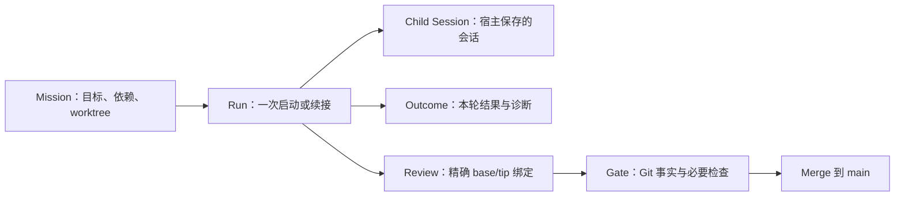

# main 整体审查与发展方向

审查日期：2026-10-27（Asia/Shanghai）。基线：`0818acc240f6bcbc951c6bb931b97d2aa0bfe640`。对象是 `/home/yangtim/dsh-tower-enhanced` 的 main；M83 仅用于评估下一步方向，未把其未合并缺陷归到 main。本轮没有修改源码、任务 state、安装副本或运行中的 Host。

**总判断：项目值得继续，Git 交付主干应保留；下一步应集中处理执行生命周期、运行记录和真实宿主验收。此前只审 M83 的结论不足以代表 main 的整体质量。**

main 已经形成完整的 Git 工作流：mission → 独立 worktree → worker 提交 → reviewer 审查 → exact base/tip 绑定 → gate → merge。这一职责分工合理，Git 相关行为也有真实临时仓库测试支撑。现在的主要风险出现在 Tower 与宿主交接执行权，以及多轮任务状态的表达上。继续单独增加 action、面板和统计，会把这些问题传播到更多地方。

## 1. main 中确认的两个缺陷

以下复现使用 main 的真实 TowerRuntime、TowerCore 和临时 Git 仓库；subagent 启动用可控替身停在等待点。没有在运行中的 DSH 上并发派发任务，因此证明的是运行时对这种合法并发顺序的处理缺陷，不是声称现场已发生事故。

**P1：同一 Session 的短调用会释放另一个调用的仓库占用。**

位置：[runtime.js:257](../../../lib/runtime.js#L257)、[runtime.js:268](../../../lib/runtime.js#L268)。`inFlight` 仅存 `root → sessionId`，无法表达同一 Session 的多个在飞调用。

复现：A 启动 M1，在 `startActivation` 返回前暂停 → A 执行一次 summary → summary 的 finally 删除 A 的占用 → B 启动 M2 被接受 → A 启动继续完成。最终同一 runtime 的 active 中同时出现 A、B 两个控制器。

这不是文档已排除的跨 Host 问题；它发生在单个 TowerRuntime 内，违反“调用在飞期间拒绝第二控制器”的承诺。应为每次调用使用独立占用 token 或引用计数，只释放自己的占用；是否串行化同一控制器的写命令应明确决定。

**P1：recover 把本 runtime 尚在启动的 run 误判为僵尸。**

位置：[runtime.js:332](../../../lib/runtime.js#L332)、[runtime.js:358](../../../lib/runtime.js#L358)、[runtime.js:625](../../../lib/runtime.js#L625)。beginSpawn 先持久化 running，active 要等 startActivation 和 attachSpawn 完成后才登记；recover 的豁免集合只读取 active。

复现：spawn 已进入宿主启动等待 → 同 Session 调用 recover → M1 被标记 worker_failed → 宿主启动返回 → runtime.active 登记了一个真实 activation，而任务仍是 worker_failed。此时 state 与执行事实冲突，send/interrupt 的状态校验也会受到影响。

应从开始启动时就追踪本 runtime 所拥有的 run；starting、running、settling 可以是内部执行阶段，不必立即增加面向用户的 mission 状态。恢复必须排除仍由本 runtime 负责的启动和结算事务。

## 2. 需要先定清楚的产品语义

这些不是本轮新发现的代码违约，部分已写进文档。但从整体方向看，它们直接影响“可靠的多代理任务管理”能做到什么。

| 当前设计事实 | 对用户的影响 | 建议方向 |
| --- | --- | --- |
| `mission.worker` 和 `mission.review` 只保存各自最新一次记录；新 worker 会清空 review | 重试后，旧 agent、审查依据和失败过程不再从当前 mission 直接可达；路由记录数甚至减少 | 把任务与每次执行分开，保留 run 摘要和 child/session 引用；当前角色记录成为 latest 指针或兼容视图 |
| `depends_on` 接受上游 merged 或 abandoned | 它表达的是“等待上游结束”，不能证明依赖的功能已提供 | 明确区分成功依赖与顺序等待。代码功能依赖建议要求成功合入；跳过依赖须显式记录决策，兼容旧 state 时不能悄悄改义 |
| 任意 Session 可以接管空闲 workspace，但宿主只允许 direct parent 恢复原 child | 能接管任务不等于能续接前一控制器的原会话 | UI/API 应指出原父 Session；同父 Session 恢复和换控制器后新派生是两条不同路径。不要为实现 resume 放松宿主血缘校验 |
| gate 记录 reviewer 的 checks 字符串，未执行或校验必需检查 | “已批准”证明流程允许合并，不证明项目测试已经运行通过 | 如果目标包含无人值守合并，增加可选的、由控制器配置的必要检查策略，记录真实命令结果并绑定提交；无需为所有任务硬编码 pnpm test |
| 所有权和 store 队列只在单个 runtime/store 内有效 | 两个 Host 的旧完成回调仍可能推翻新控制器的 recover 结果 | 这是已声明的边界。先修好单 Host 保证；如继续只支持单 Host，优先检测并拒绝双写，暂不建设分布式调度或复杂租约系统 |

隔离特征验证确认：重新启动 worker 后，当前路由记录总数可从 2 降到 1；上游 abandoned 后，下游 worker 可启动；两个 core 的模拟旧回调可把 recover 后的 worker_failed 改回 worker_completed。这些结果与当前实现/已声明边界一致，不应混入“新增漏洞”数量。

**最小数据模型方向：**

一个 mission 可以有多次 run；新派生通常换 child，resume 可以复用原 child。Tower runId、宿主 hostRunId、childId、controllerSessionId 不应互相代替。保留有限字段的运行记录即可，完整会话仍由宿主存储，无需在 Tower 再造一套聊天数据库。

## 3. 数据发布正在为旧历史重复付出成本

[runtime.js:210](../../../lib/runtime.js#L210) 每次 publish 都把全塔 public state 追加进控制器 Session 并 flush。当前实际 81 个任务，compact JSON 测得：

| 内容 | 字节数 |
| --- | ---: |
| 一份完整 public state | 1,032,711 |
| 全部 mission description | 191,729 |
| 当前 worker 记录 | 193,364 |
| 当前 review 记录 | 593,584 |
| compact summary | 30,069 |

字段分类不构成完整总和。这里测的是序列化体积，没有测真实 Session 累积磁盘占用，也没有把这些字节换算成模型 token。plugin record 是否进入模型输入不能靠字节数推定。

这个发布方式意味着任务越多，每次新任务仍反复复制旧任务报告。state 的 events 保留 200 条并不能限制历史任务数或 Session 中累计的完整快照。现有 100-mission 冒烟使用很短的描述、无 worker output 的合成记录，也未测 Session 发布链，不能据此排除真实报告体积引起的增长。

建议：发布用于面板的紧凑状态和单调 revision，按任务/run 获取详情；采用变更记录加有限检查点，或宿主支持的 workspace 资源，而不是每次追加所有报告。新增 run 历史时尤其要避免把所有旧 run 的完整 output 再放进每一份快照。

## 4. 应保留与应收敛的部分

**保留：** exact base/tip 审查绑定、只 merge 已审 SHA、scope 与 clean 检查、保守 teardown、Git 已完成但落账失败时的对账设计，以及 core/runtime/git/store 的大体分层。main 的普通 reviewer 通过宿主 structured_output capture 接收结果；上一份 M83 报告中的文本 JSON 解析缺陷不能直接外推为 main 普通 spawn 的同一问题。

**收敛：** 后续工作优先围绕“任务能启动、真实状态能看懂、失败可继续、结论可追溯、正确合入”这条用户路径。现有 mission 列表中已有大量文档一致性、测试矩阵、发布脚本和面板细节任务；它们有维护价值，但继续扩展这些周边能力不应先于真实宿主闭环。

发布脚本约 878 行，runtime/core/store/git 合计约 1,819 行；这个比例本身不证明设计错误，但项目目前没有远程仓库，继续扩建发布设施的收益需要明确使用场景。无需删除已经完成的工具，也不建议重新分拆整个仓库；先停止自动衍生与当前用户路径无关的维护任务。

reviewer 的只读和 worker 的目录范围仍主要是指令约束，worktree 不构成能力沙箱。文档对此坦诚。应优先使用宿主已有的权限与工具能力约束做验证；Tower 继续承担任务与交付流程，避免另造权限系统或把 LLM review 描述成安全认证。

## 5. 验收证据需要从内部契约延伸到宿主边界

本轮在 main、Node v24.19.0 上运行：`pnpm test` 505/505；`pnpm run check` exit 0。新增诊断包含 2 项应成立但失败的生命周期断言，以及 3 项通过的设计特征验证。

现有 Git 集成测试大量使用真实临时仓库，这是实质证据。但 runtime 启动边界以 stub 为主，client 测试以 VM/组件树替身为主；本轮未发现仓库中对真实 SubagentManager/coldResume、持久化 Session 及真实 GUI 完整路径的覆盖。本轮也未重启或实测安装中的插件，未运行 GitHub CI 或最低 Node 版本矩阵。

下一阶段应补少量覆盖边界的高价值场景：

1. 从插件注册的 tower 入口启动 worker、提交、review、gate、merge，并在真实宿主界面核对结果。
2. 启动中取消/卸载、启动中 recover、并发短调用、结算失败；确保任务记账与真实 activation 一致。
3. 同父 Session 重载后恢复原 child、异父拒绝、连续两轮恢复、模型错误诊断、非法 reviewer 输出拒绝。
4. 从已安装包运行而非只从源码导入，核对所加载版本，并以 disposable 仓库执行验收。

真实宿主 fixture 可替换模型执行边界来避免费用，但应保留真实 Session、descriptor 与生命周期管理；最后用少量实际操作确认界面和安装接线。避免再用新增几十个内部断言的数量代表交付成熟度。

## 6. 调整后的实施优先级

**第一批：修 main 的执行所有权与启动登记。** 接受本报告的两个并发复现作为回归，明确 pending/running/settling 的内部归属。这个修补可以小范围完成，不需要等大重构。

**第二批：确定 mission/run/child/controller 的持久关系，并收敛发布载荷。** 保留旧 state 的兼容入口；运行历史保存摘要与引用，避免复制全会话。定清 dependencies 与跨控制器交接的语义。

**第三批：在上述身份模型上完成 M83，并做真实宿主闭环。** 原会话续接是有价值的用户功能，应继续推进；它不宜仅作为当前覆盖式 worker/review 记录上的附加按钮。WAL、epoch 绑定、严格 reviewer 校验及取消清理仍按 M83 报告修复。

**后续：按使用场景增加必要检查策略、权限限制和交互改进。** UI 统计、发布工具、文档守卫以支撑上述路径为准，不再独立扩张路线图。

这不是推倒重写建议。主线应保留 Git 交付控制层的定位，先补牢执行与历史模型，再让续接功能建立在可解释、可验证的生命周期上。

证据：[定向验证脚本](./main-probes.test.mjs)、[定向验证日志](./evidence/main-probes.log)、[main 回归日志](./evidence/main-regression.log)。脚本在当前基线上应以 2 failed / 3 passed、退出码 1 结束；它不会修改真实项目 state。
